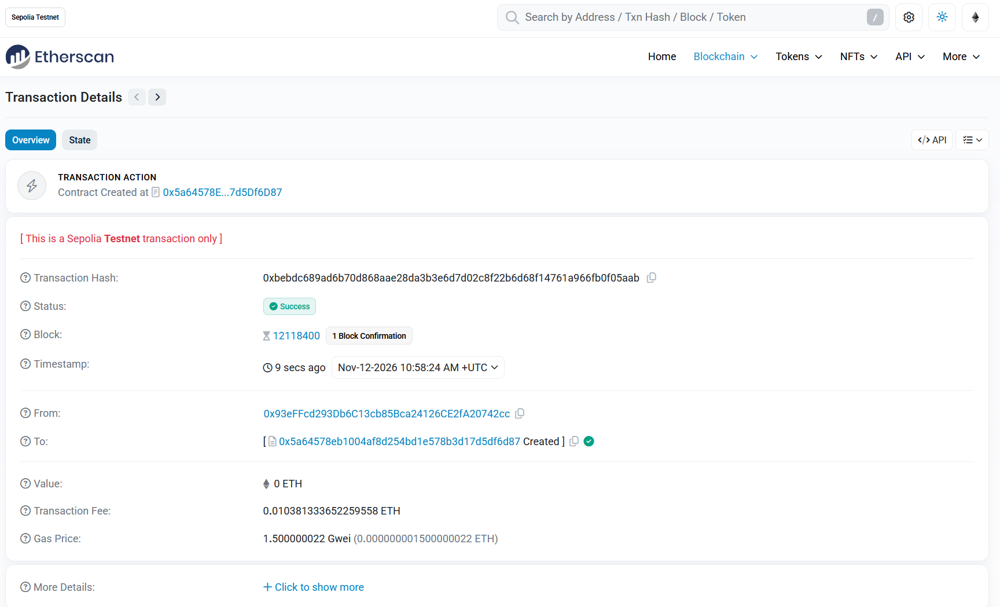
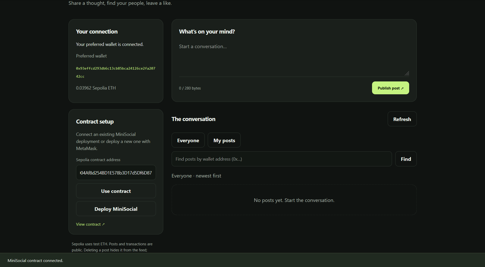

# MiniSocial — Sepolia

A small Ethereum social network with a Solidity contract, a plain HTML/CSS/JavaScript frontend, and MetaMask signing. Publish public posts, browse everyone or a specific wallet, like/unlike, and delete your own posts.

Configured network: **Sepolia (11155111)**.
Preferred wallet: **0x93eFFcd293Db6C13cb85Bca24126CE2fA20742cc**.
Wallet addresses are compared case-insensitively. This is an account address, not a deployed contract address.

## Start locally

Before installing, clone the repository and enter the app directory:

```sh
git clone https://github.com/mohammed-stalin/blockchain.git
cd blockchain/chain
```


Use Node.js 22 LTS with this Hardhat 2 project.

```sh
npm ci
npm test
npm start
```

Open **http://127.0.0.1:3000** in a browser with MetaMask.

1. Click **Connect wallet** and select your preferred account.
2. Approve switching to Sepolia if prompted.
3. Click **Deploy MiniSocial** and review/sign the deployment in MetaMask. Deployment requires Sepolia test ETH.
4. After confirmation, the app saves the contract address in this browser.
5. Publish a post. Each write requires a MetaMask transaction approval.

No private key or recovery phrase is needed by the app. The app does not send ETH to the preferred wallet; test ETH pays network transaction fees.

To use an existing deployment of **this version** of MiniSocial, enter its address and click **Use contract**. The app checks for code and the expected read methods on Sepolia. Older MiniSocial deployments may have incompatible interfaces.

For a shared default deployment, put the confirmed contract address in `app-config.js`. Browser-saved addresses take precedence and can be replaced in the setup panel. Do not put your wallet address in the contract-address field.

`npm start` compiles the contract and generates `deployment-artifact.json` with its ABI and bytecode, then runs a local server. Ethers is served from the locked local dependencies; no browser CDN is required. The server binds to loopback and serves only app files.

## Host on GitHub Pages

Build a self-contained static bundle:

```sh
npm run build
```

The generated `dist/` folder contains the frontend, the locked Ethers browser bundle and license, and the compiled MiniSocial ABI/bytecode. It excludes private keys, environment files, the Node server, and development dependencies. Asset URLs are relative so the app works under a repository path such as `/blockchain/`.

To publish this repository:

1. Push the commits to GitHub.
2. In **Settings > Pages > Build and deployment**, set **Source** to **GitHub Actions**.
3. In **Actions**, choose **Deploy MiniSocial to GitHub Pages** and click **Run workflow** on `main`.
4. After tests and deployment pass, open the URL from the workflow's `github-pages` environment.

The workflow is manual; committing or pushing alone does not publish the website. It uses the standard [GitHub Pages artifact and deployment workflow](https://docs.github.com/en/pages/getting-started-with-github-pages/using-custom-workflows-with-github-pages).

The hosted origin has separate browser storage from localhost. Set a shared default contract in `app-config.js` before building, or enter your existing Sepolia contract address in the hosted app. Hosting the website does not deploy a smart contract; transactions still require MetaMask signatures.


## Screenshots

These screenshots show the Sepolia workflow: connecting MetaMask, deploying MiniSocial, checking the deployment, and publishing a first post.

### 1. Connect MetaMask

Select the preferred wallet and approve the connection to the local app.


### 2. Deploy MiniSocial

Review the contract deployment request on Sepolia in MetaMask.


### 3. Check the deployment on Etherscan

The Sepolia Etherscan transaction page shows a successful contract creation.



### 4. Connect to the deployed contract

The app connects to the deployed MiniSocial contract and enables the composer and feed controls.



### 5. Confirm a post transaction

Write a post, click **Publish post**, and review the transaction request in MetaMask.


### 6. View the published post

After confirmation, the post appears in the feed with its author, timestamp, and reaction controls.


## Behavior

- Posts accept 1–280 UTF-8 bytes. Emoji and accented letters can take multiple bytes.
- The global and per-author feeds are paginated, newest first.
- Each wallet can like a post once. **Remove like** removes that wallet's own like; it cannot subtract another person's reaction.
- Only the post author can delete it. Deletion clears the current content and hides the feed entry, but historical blockchain data and publication events remain public.
- Post ids never change when another post is deleted.
- Account/network changes clear the active session and require reconnecting.
- Other wallets can publish and react. The frontend's preferred-wallet check restricts its deployment button only; the contract itself is permissionless.
- The feed is manually refreshed; **Load more** fetches the next 20 stored entries. Counts include deleted entries.

## Commands

```sh
npm run compile
npm run test:contracts
npm run test:web
npm run prepare:app
npm start
```

`npm test` runs the contract, local-server, and Pages bundle checks, including asset loading under a repository subpath.

Optional CLI deployment:

```sh
npx hardhat ignition deploy ignition/modules/MiniSocial.js --network sepolia
```

The CLI reads `SEPOLIA_RPC_URL` and `SEPOLIA_PRIVATE_KEY` from process environment variables. It does not automatically load a .env file. Prefer browser deployment with MetaMask so no exported key is needed. After CLI deployment, copy the returned MiniSocial contract address into the app.

## Files

- `contracts/MiniSocial.sol`: social contract.
- `ignition/modules/MiniSocial.js`: optional Hardhat Ignition deployment.
- `test/MiniSocial.js`: social contract tests.
- `index.html`, `styles.css`, `app.js`: frontend.
- `app-config.js`: public network, wallet and default contract settings.
- `scripts/prepare-app.js`: exports the compiled deployment artifact.
- `scripts/serve.js`: local allowlisted web server.
- `scripts/build-pages.js`: public static bundle for GitHub Pages.
- `../.github/workflows/pages.yml`: manual test, build and deployment workflow.
- `test-web/server.test.js`: server and artifact integration checks.

The original `Lock.sol`, Lock deployment module, and Lock tests are retained as a separate Hardhat example. They are not used by MiniSocial.

The screenshots document a deployment and a published post on Sepolia. Editing or starting this repository does not deploy another contract; deployment requires a signed wallet transaction. Wallet balances shown by the app are read live from Sepolia.

References: [Hardhat 2 configuration](https://v2.hardhat.org/hardhat-runner/docs/config), [MetaMask transaction signing](https://docs.metamask.io/metamask-connect/evm/reference/json-rpc-api/eth_sendTransaction/).
