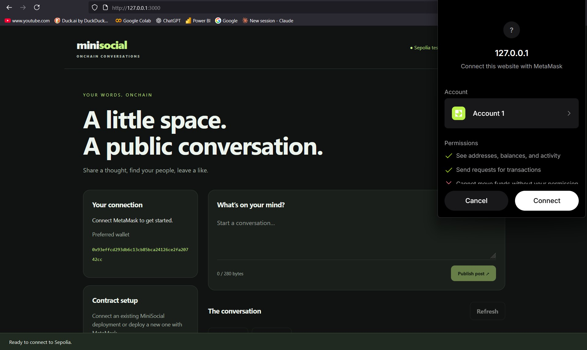
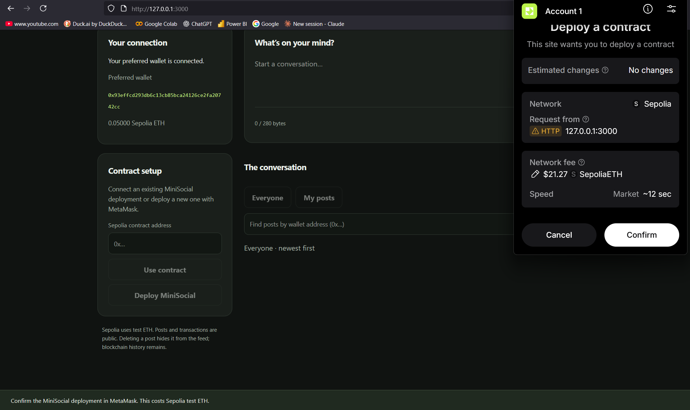
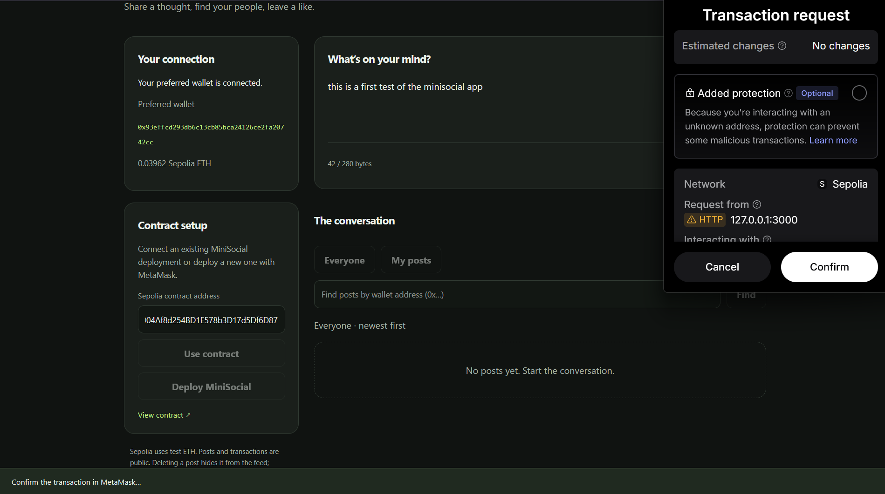
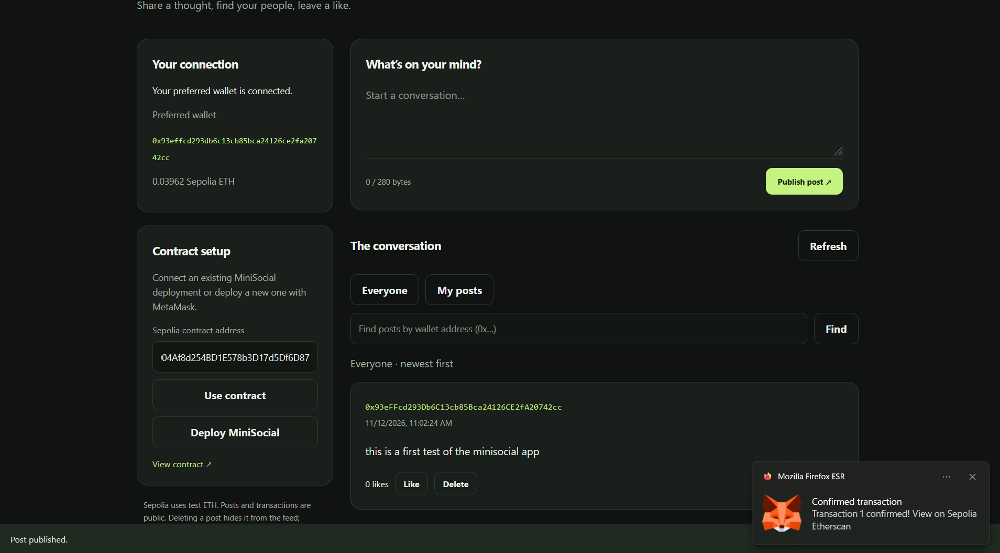

# MiniSocial - Project Report

MiniSocial is a decentralized social application developed with Solidity, Hardhat, JavaScript, and MetaMask. This report follows the practical workflow: create two accounts, obtain Sepolia test ETH, run the project locally, deploy the smart contract, and test interaction between the accounts.

## 1. Creating the MetaMask accounts

### 1.1. Install MetaMask and create the first account

1. Install the browser extension from [MetaMask's official website](https://metamask.io/).
2. Open the extension and choose **Create a new wallet** if you do not already have one.
3. Complete the wallet setup and set a password. For recovery-phrase setup, store the Secret Recovery Phrase privately and offline.
4. Name the first account **Account 1 - Author**, or another recognizable name.
5. Copy its Ethereum address, which starts with `0x`. This public address identifies the author and receives test ETH.

MiniSocial and the faucet only need your public address. Never enter a recovery phrase or private key into either application. See [MetaMask's wallet creation guide](https://support.metamask.io/start/creating-a-new-wallet).

### 1.2. Create a second account

Open MetaMask's account selector and choose the option to **Add account or wallet**, then create a new Ethereum account. Give it a name such as **Account 2 - Reader**, and copy its `0x` address. Menu labels can vary between extension versions; [MetaMask's account guide](https://support.metamask.io/configure/accounts/how-to-add-accounts-in-your-wallet/) explains the current flow.

The two accounts represent different users of the application:

| Account | Role in the demonstration |
| --- | --- |
| Account 1 | Deploy the contract and publish a post. |
| Account 2 | Connect to the same contract and like Account 1's post. |

Each account has its own address, balance, and reactions. Creating another account in the same wallet is sufficient for this demonstration.

### 1.3. Select the Sepolia network

In MetaMask, open **Networks**, enable **Show test networks**, and select **Sepolia**. Refer to the [official test-network instructions](https://support.metamask.io/configure/networks/how-to-view-testnets-in-metamask/) if the option is hidden.

The project uses Ethereum Sepolia, with chain ID **11155111**. Both accounts must use this network for the demonstration.

## 2. Obtaining 0.05 Sepolia ETH from Google Cloud

Sepolia ETH pays the gas fees for deployment, publishing, and reactions. It is a test token with no real-world monetary value.

1. Select **Account 1** in MetaMask and copy its public Ethereum address.
2. Open the [Google Cloud Ethereum Sepolia Faucet](https://cloud.google.com/application/web3/faucet/ethereum/sepolia).
3. Sign in with your Google account if prompted.
4. Check that the selected network is **Ethereum Sepolia**.
5. Paste Account 1's address into **Wallet address or ENS name**.
6. Click **Get 0.05 Sepolia ETH** and complete any requested verification.
7. Wait for confirmation, then check the Sepolia balance in MetaMask. The faucet transaction can also be followed on [Sepolia Etherscan](https://sepolia.etherscan.io/).

The [Google Cloud faucet](https://cloud.google.com/application/web3/faucet/ethereum/sepolia?hl=ja) lists a 0.05 Sepolia ETH drip. Requests are limited by Google account and recipient address; follow the limits shown by the service.

Account 2 also needs gas to submit a like. Request funds for its address when permitted, or send a small portion of Account 1's Sepolia ETH to Account 2 through MetaMask. Leave enough in Account 1 to deploy and publish. The transfer itself also consumes gas.

## 3. Setting up and running the project

### 3.1. Prerequisites

Prepare Git, Node.js **22**, npm, and a browser with MetaMask installed. Use an internet connection for dependency installation, initial compiler downloads, and Sepolia access. The frontend runs locally; its smart contract runs on Sepolia.

### 3.2. Download the source code

```sh
git clone https://github.com/mohammed-stalin/blockchain.git
cd blockchain/chain
```

If the repository is already downloaded, open a terminal in its `chain` directory instead.

### 3.3. Install dependencies

```sh
npm ci
```

This installs the versions recorded in `package-lock.json`, including Hardhat, its toolbox, and Ethers.

### 3.4. Configure the deployment account

The public configuration is in [`app-config.js`](app-config.js). The current preferred deployment account is:

```text
0x93effcd293db6c13cb85bca24126ce2fa20742cc
```

If Account 1 has a different address, replace `preferredWallet` with Account 1's public address before starting. The frontend enables **Deploy MiniSocial** only for this configured account. Other accounts can still publish and react.

Leave `chainId` as `11155111`. For a first deployment, leave `contractAddress` empty. After deployment, the app remembers the contract address in this browser. You can also set `contractAddress` to an existing compatible MiniSocial deployment.

The MetaMask workflow does not require exporting a private key or creating an environment file.

### 3.5. Run the checks

```sh
npm test
```

This runs the Solidity tests and frontend checks, including account switching, logout, local asset serving, and static bundle generation. The Solidity tests use Hardhat's local test network and do not spend your Sepolia ETH.

### 3.6. Start the local application

```sh
npm start
```

This compiles the contracts, generates `deployment-artifact.json` with the MiniSocial ABI and bytecode, and starts the local web server. Open **http://127.0.0.1:3000** in the browser containing MetaMask.

Keep the terminal running while using the app. Press **Ctrl+C** to stop the server.

## 4. Deploying MiniSocial on Sepolia

### 4.1. Connect Account 1

Click **Connect wallet**, choose Account 1 in MetaMask, and approve the connection. Accept the switch to Sepolia if prompted. The app displays the connected wallet's Sepolia balance.



### 4.2. Deploy the smart contract

Click **Deploy MiniSocial**, review the deployment request in MetaMask, and confirm it. Wait until the transaction is confirmed. Deployment spends Sepolia ETH on gas.



After confirmation, use **View contract** to inspect the deployment on Etherscan.


The app saves the deployed contract address and loads its feed.


An account address identifies a user; a contract address identifies the deployed application. To reuse an existing deployment, enter its **contract address** in **Sepolia contract address** and click **Use contract**. The app checks that the address contains compatible contract code.

## 5. Publishing and interacting with posts

### 5.1. Publish a post using Account 1

Enter a message in the composer, click **Publish post**, and confirm the transaction in MetaMask. Messages must contain between **1 and 280 UTF-8 bytes**; some characters use more than one byte.



After confirmation, the feed displays the post's author, timestamp, content, and reaction controls.



### 5.2. Switch to Account 2 and like the post

1. Click **Logout**, then **Connect wallet**, and select Account 2 in MetaMask. Alternatively, click **Switch account** while connected.
2. Confirm that Account 2 is selected and has Sepolia ETH for gas.
3. Keep the same MiniSocial contract address. There is no need to deploy a second contract.
4. In **Everyone**, locate Account 1's post and click **Like**.
5. Confirm the transaction using Account 2 in MetaMask and wait for confirmation.

The like count increases, and Account 2's button becomes **Remove like**. Clicking it submits another transaction to remove that account's reaction. Each wallet can like a post only once at a time.

Logout clears the active app session, draft, and feed while preserving the selected contract address. It does not lock MetaMask or revoke the extension's site permissions. If a wallet does not support the account picker, select the account in the extension and reconnect.

### 5.3. Browse and delete posts

Use **Everyone** for the global feed, **My posts** for the connected account, or the address search to find a particular author. **Refresh** reloads the feed, and **Load more** retrieves another page of up to 20 stored entries.

Only the author can delete a post. Deletion hides it from the current feed and clears its current content in contract storage; historical transactions and emitted events remain public.

## 6. Technical implementation

The browser uses Ethers to read the contract through MetaMask's provider. For a write operation, MetaMask asks the selected account to approve a transaction, which is then sent to Sepolia. The frontend refreshes the feed after confirmation.

The Solidity contract stores posts with stable IDs, author addresses, timestamps, like counts, and deletion flags. It indexes posts by author and records reactions by post ID and wallet address. Contract checks enforce message length, reaction uniqueness, and author-only deletion.

| File or directory | Purpose |
| --- | --- |
| [`contracts/MiniSocial.sol`](contracts/MiniSocial.sol) | Stores posts and enforces publishing, reaction, and deletion rules. |
| [`test/MiniSocial.js`](test/MiniSocial.js) | Tests the social contract's behavior and restrictions. |
| [`index.html`](index.html), [`styles.css`](styles.css), [`app.js`](app.js) | Implement the interface and wallet interaction. |
| [`app-config.js`](app-config.js) | Defines the network, preferred account, and optional contract address. |
| [`hardhat.config.js`](hardhat.config.js) | Configures Solidity 0.8.27, optimization, and Sepolia. |
| [`scripts/prepare-app.js`](scripts/prepare-app.js) | Exports the compiled ABI and deployment bytecode. |
| [`scripts/serve.js`](scripts/serve.js) | Serves the frontend and its allowed assets locally. |
| [`test-web/`](test-web) | Checks frontend sessions, server responses, and bundle assets. |

The original `Lock.sol` example and its tests remain in the repository as a separate Hardhat exercise.

## 7. Validation and observations

The existing screenshots document a Sepolia deployment and a published post. The second-account procedure above explains how to extend that demonstration with a reaction; the screenshots do not document that additional transaction.

The automated checks cover publishing, byte limits, pagination, one like per wallet, removing a like, author-only deletion, and rejected operations on unavailable posts. Frontend checks cover clearing sessions, connecting a second account, signing a reaction with that account, cancelled account selection, and wallets without the permissions API.

Useful commands, run from `chain`:

| Command | Purpose |
| --- | --- |
| `npm run compile` | Compile the smart contracts. |
| `npm run test:contracts` | Run the Hardhat contract tests. |
| `npm run test:web` | Generate frontend assets and run the web checks. |
| `npm test` | Run both test groups. |
| `npm run prepare:app` | Compile and generate the browser contract artifact. |
| `npm start` | Prepare the application and serve it locally. |

## 8. Common setup issues

| Problem | Resolution |
| --- | --- |
| Sepolia is missing in MetaMask | Enable **Show test networks** in the network list. |
| Faucet request is refused | Check the selected network and address, then follow the faucet's displayed eligibility or waiting period. |
| Insufficient funds | Fund the account signing the transaction with Sepolia ETH. |
| Deploy button is disabled | Connect the account configured as `preferredWallet` in `app-config.js`. |
| No contract exists at the entered address | Use the confirmed Sepolia contract address, rather than an account address. |
| No posts appear after changing accounts | Connect both accounts to the same contract and select **Everyone**. |
| Wallet or network changed | Reconnect on Sepolia before continuing. |
| A transaction is rejected | Retry the action and approve the request in MetaMask if you want to submit it. |

The local application and the Sepolia contract together demonstrate wallet identity, persistent public posts, transaction confirmation, and interaction between two accounts.
